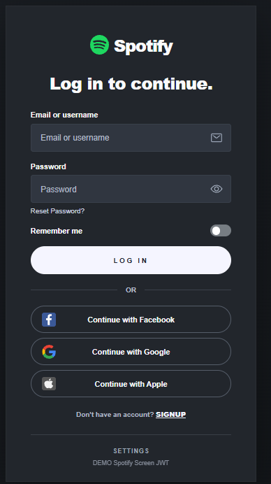
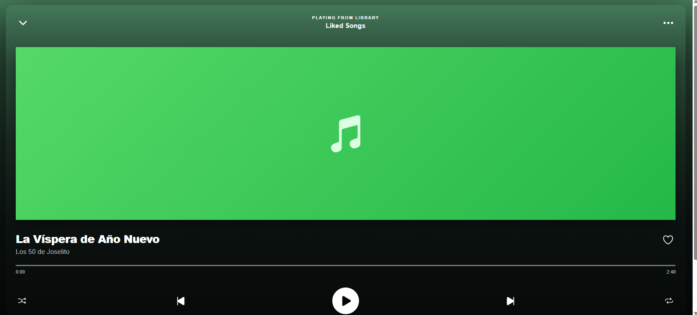

##  Integrantes del proyecto

| N.º | Nombre |
|:---:|---|
| 01 | **Daniel Felipe Rodriguez Garcia** |
| 02 | **Danna Valentina Pulido Guavita** |
| 03 | **Leidy Vanessa Zambrano Bogoya** |
| 04 | **Johan Stivens Rojas Lozano** |
| 05 | **Edison Fabian Garzon Pineros** |

---


<div align="center">

#  Spotify UI 

### Ionic + Angular · Node.js + Express · Autenticación JWT

**Aplicación académica inspirada en Spotify:** inicio de sesión con validaciones, autenticación JWT y reproductor musical, diseñada para web y pantallas móviles.


&nbsp;&nbsp;


</div>

---

## Contenido

- [Descripción](#-descripción-del-proyecto)
- [ Vistas previas](#️-vistas-previas)
- [ Tecnologías](#-tecnologías-utilizadas)
- [ Autenticación JWT](#-cómo-funciona-la-autenticación-jwt)
- [ Integrantes](#-integrantes-del-proyecto)
- [ Estructura](#-estructura-del-proyecto)
- [ Instalación](#️-instalación-y-ejecución-del-proyecto)
- [ Credenciales](#-credenciales-de-prueba)
- [ Cierre de sesión](#-cómo-cerrar-sesión)
- [ Compatibilidad móvil](#-compatibilidad-móvil)
- [ Scripts y pruebas](#️-scripts-principales)

## Descripción del proyecto

**Spotify UI ** es una aplicación inspirada en la interfaz de Spotify y en el proyecto inicial [PantallasGrillas](https://github.com/Johan140726/PantallasGrillas). Se desarrolló con **Ionic + Angular**, **TypeScript** y **SCSS** en el frontend, y con **Node.js + Express** en el backend.

El objetivo es combinar una interfaz responsive de **dos pantallas** con un flujo de autenticación propio basado en **JSON Web Tokens (JWT)**.

### Funcionalidades

- Inicio de sesión con diseño oscuro inspirado en Spotify.
- Validación de correo electrónico y contraseña antes del envío.
- Mostrar u ocultar la contraseña.
- Opción **Remember me** para recordar únicamente el correo de la demo.
- Validación de credenciales en el backend con **bcrypt**.
- Sesión mediante **JWT** firmado y almacenado en cookie **HttpOnly**.
- Protección de la ruta `/home` mediante **Auth Guard**.
- Redirección directa del login al reproductor.
- Reproductor musical con fondo verde, barra de progreso y controles.
- Reproducción local si se proporciona un MP3 autorizado.
- Cierre de sesión mediante el menú de tres puntos.
- Interfaz adaptable a navegadores de escritorio y móviles.
- Base Ionic preparada para una adaptación posterior con Capacitor.

---

##  Vistas previas

### Pantalla de login

Formulario con colores oscuros, identidad visual estilo Spotify, campos validados y opciones visuales de acceso social.

<p align="center">
  
</p>

**Incluye:** correo obligatorio con formato válido, contraseña obligatoria con requisitos, control para mostrar/ocultar, opción **Remember me** y mensajes de error.


###  Pantalla del reproductor

Reproductor inspirado en el diseño original de grillas de Ionic.

<p align="center">
  
</p>

| Elemento | Información |
|---|---|
|  Canción | **La Víspera de Año Nuevo** |
|  Artista | **Los 50 de Joselito** |
|  Diseño | Degradado verde a negro, carátula verde y controles de reproducción |
| ▶Audio | Se reproduce dentro de la app si existe un archivo MP3 autorizado; si no, se ofrece la grabación oficial externa |
|  Sesión | Cierre de sesión desde el menú de los tres puntos |


## Tecnologías utilizadas

| Capa | Tecnologías | Uso |
|---|---|---|
| **Frontend** | Ionic, Angular, TypeScript, HTML, SCSS | Pantallas, diseño responsive y formularios |
| **Backend** | Node.js, Express | API de autenticación |
| **Seguridad** | JWT, bcrypt, cookies HttpOnly | Validación de credenciales y sesión |
| **Móvil** | Capacitor (configuración base) | Adaptación futura a Android |

---

##  ¿Cómo funciona la autenticación JWT?

1. El usuario ingresa su correo y contraseña en el formulario.
2. Angular valida los campos y envía los datos a `POST /api/auth/login`.
3. El backend compara la contraseña con un hash utilizando **bcrypt**.
4. Si las credenciales son correctas, el servidor firma un **JWT** con una duración de **1 hora**.
5. El JWT se entrega en la cookie `pg_music_access`, marcada como **HttpOnly** y `SameSite=Lax`.
6. El guard de Angular consulta `GET /api/auth/me` para verificar la sesión antes de abrir `/home`.
7. Si el token falta, está alterado o ha expirado, la API rechaza la solicitud y la aplicación redirige al login.

```text
┌─────────────────────┐      POST /api/auth/login      ┌─────────────────────┐
│   Ionic + Angular   │ ──────────────────────────────▶ │   Node.js + Express │
│  Login de prueba    │ ◀────────────────────────────── │ bcrypt + JWT        │
└─────────────────────┘    Cookie JWT HttpOnly          └─────────────────────┘
           │                                                 ▲
           │             GET /api/auth/me                     │
           └─────────────────────────────────────────────────┘
           │
           ▼
      /home protegido
```

### Validaciones de seguridad implementadas

- Correo electrónico obligatorio y con formato válido.
- Contraseña obligatoria de **8 a 128 caracteres**, con mayúscula, minúscula, número y símbolo.
- Verificación de contraseña con **bcrypt** en el servidor.
- Token JWT firmado con **HS256** y expiración definida.
- Cookie **HttpOnly**: el frontend no necesita leer el valor del token desde JavaScript.
- Protección de rutas y rechazo de solicitudes sin sesión válida.
- Limitación de intentos de inicio de sesión en el backend.
- Cierre de sesión que elimina la cookie desde la API.

> **Seguridad:** estas medidas corresponden a una **demo académica**. Para producción deben configurarse HTTPS, un `JWT_SECRET` persistente y secreto, gestión real de usuarios, políticas de origen/cookies adecuadas y protección CSRF según el despliegue.

---


## 📁 Estructura del proyecto

```text
SpotifyScreenJWT/
│
├── backend/
│   ├── src/
│   │   └── server.js
│   ├── tests/
│   ├── .env.example
│   └── package.json
│
├── frontend/
│   ├── src/
│   │   ├── app/
│   │   │   ├── guards/
│   │   │   ├── services/
│   │   │   ├── spotify-login/
│   │   │   └── home/
│   │   └── assets/
│   │       ├── audio/
│   │       └── icons/
│   ├── angular.json
│   ├── capacitor.config.ts
│   ├── ionic.config.json
│   └── package.json
│
├── docs/
│   ├── login.png
│   └── reproductor.png
│
├── .gitignore
├── package.json
└── README.md
```


## Instalación y ejecución del proyecto

### Requisitos

- **Node.js 22 o superior** y npm.
- **Visual Studio Code** (recomendado).
- Navegador Chrome, Edge u otro navegador moderno.
- Conexión a internet para instalar las dependencias por primera vez.

### 1. Clonar el repositorio

Una vez creado y publicado el repositorio en GitHub, reemplaza `NOMBRE-DEL-REPOSITORIO` por su nombre real:

```bash
git clone https://github.com/Johan140726/SpotifyScreen.git
cd SpotifyScreen
```

También puedes abrir directamente tu carpeta local `SpotifyScreenJWT` si ya la tienes descargada.

### 2. Instalar dependencias

Abre la **carpeta raíz del proyecto**, donde está el `package.json` principal, y ejecuta desde la terminal integrada de VS Code:

```bash
npm run instalar
```

Este comando instala las dependencias de `backend` y `frontend`.

### 3. Iniciar el backend — Terminal 1

En **Terminal → New Terminal**:

```bash
npm run backend
```

El backend queda disponible en:

```text
http://localhost:3000
```

**Deja esta terminal abierta.** Es el servidor que valida las credenciales y verifica los JWT.

### 4. Iniciar el frontend — Terminal 2

Abre otra terminal integrada con el botón **+** y ejecuta desde la **misma raíz**:

```bash
npm run frontend
```

La aplicación Angular/Ionic estará disponible en:

```text
http://localhost:4200
```


---

## 🔑 Credenciales de prueba

| Campo | Valor |
|---|---|
|  Correo | `demo.spotify@ejemplo.com` |
|  Contraseña | `DemoSegura2026!` |

> Son credenciales **únicamente de demostración**, definidas para el backend local. **No son credenciales de Spotify** y no deben reutilizarse en un sistema real.

---

##  Flujo de uso

1. Inicia el backend con `npm run backend`.
2. Inicia el frontend con `npm run frontend`.
3. Abre `http://localhost:4200`.
4. Ingresa el correo y la contraseña de prueba.
5. Al validar las credenciales, entrarás directamente a `/home`.
6. Usa los controles del reproductor y el menú de opciones.
7. Para salir, selecciona **Cerrar sesión**.
8. Si intentas abrir `/home` sin una sesión válida, regresarás al login.

---

##  Cómo cerrar sesión

Dentro del reproductor:

1. Pulsa el botón de **tres puntos (•••)** en la esquina superior derecha.
2. Selecciona **Cerrar sesión**.
3. La aplicación ejecuta `POST /api/auth/logout`, elimina la cookie de autenticación y regresa a `/spotify-login`.

Puedes comprobarlo en Chrome en **F12 → Application → Cookies → `http://localhost:4200`**: tras cerrar sesión, la cookie `pg_music_access` ya no debe aparecer.

---

##  Validaciones implementadas

### En el formulario

- Correo obligatorio y validación de formato.
- Contraseña obligatoria y comprobación de complejidad.
- Mostrar y ocultar contraseña.
- Mensajes cuando el backend no está disponible o rechaza las credenciales.
- **Remember me** guarda el correo de prueba, **no la contraseña ni el JWT**.

### En la autenticación

- Hash **bcrypt** para comprobar la contraseña de la cuenta demo.
- Token **JWT** emitido por el servidor y enviado mediante cookie `HttpOnly`.
- Verificación del token en `/api/auth/me`.
- Ruta `/home` protegida mediante guard.
- Cierre de sesión funcional.
- Redirección al login sin sesión válida.


## 🛠️ Scripts principales

Todos estos comandos se ejecutan en la **raíz** del proyecto:

| Comando | Función |
|---|---|
| `npm run instalar` | Instala dependencias del frontend y backend |
| `npm run backend` | Inicia la API JWT en el puerto 3000 |
| `npm run frontend` | Inicia Ionic + Angular en el puerto 4200 |
| `npm run test:backend` | Ejecuta pruebas automatizadas de backend |
| `npm run build:frontend` | Compila el frontend |


